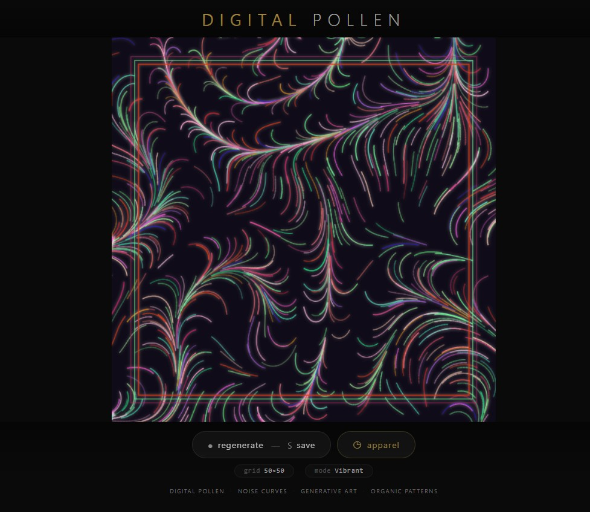
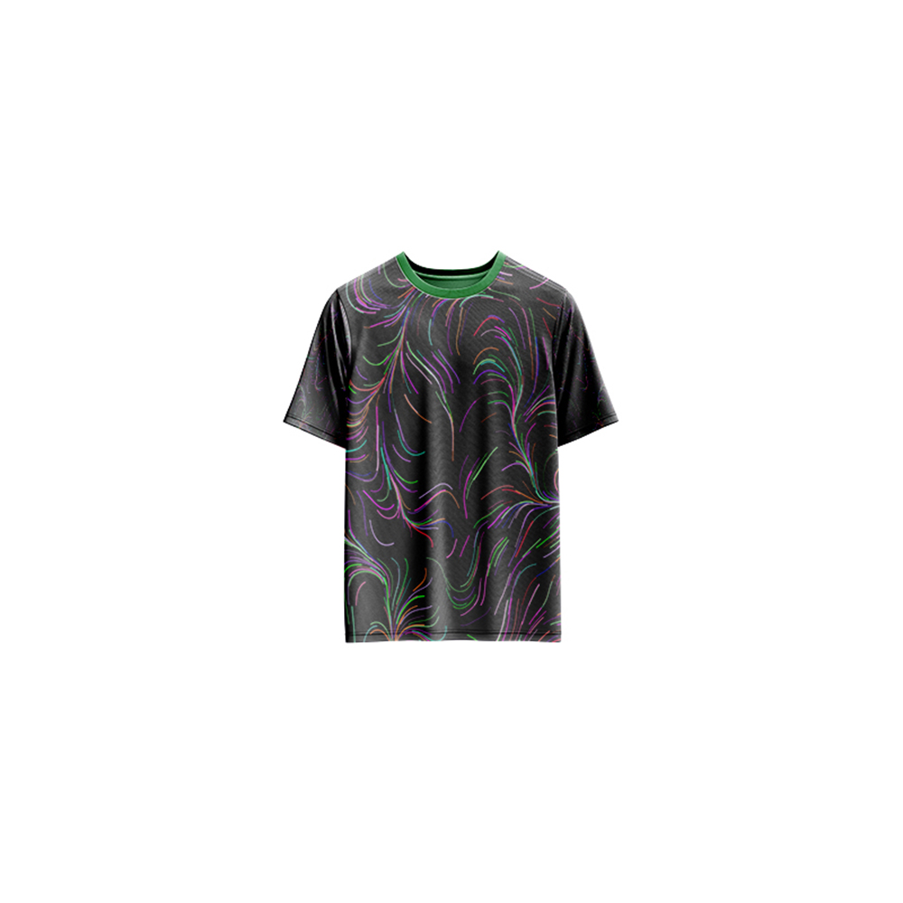

# Digital Pollen — Generative Art

[](https://reyrove.github.io/Digital-Pollen-Generative-Art)
[](https://opensource.org/licenses/MIT)

> **Generative noise art with organic, pollen-like patterns.** Each refresh creates a unique composition of flowing curves and vibrant colors, resembling digital pollen drifting across a dark field.

## 🎨 Live Demo

<div align="center">
  <a href="https://reyrove.github.io/Digital-Pollen-Generative-Art" target="_blank">
    
  </a>
  <br><br>
  <a href="https://reyrove.github.io/Digital-Pollen-Generative-Art" target="_blank">
    
  </a>
  <br>
  <em>Click the image or button to experience the generative art</em>
</div>

## 👕 Apparel Preview

<div align="center">
  
  <br>
  <em>Digital Pollen artwork printed on a T-shirt</em>
</div>

## ✨ Features

- **Noise-Driven Curves** — Organic flowing lines using 3D value noise
- **8 Color Palettes** — Vibrant and gothic color schemes
- **Goth Mode** — Darker, moodier color variations
- **Grid System** — Curves distributed across a grid with random density
- **Decorative Elements** — Layered rectangular frames
- **Glow Effects** — Soft shadows for depth
- **Save & Share** — Download as PNG
- **Apparel Mode** — Preview artwork on a T-shirt mockup
- **Responsive** — Works on desktop, tablet, and mobile
- **Pure JavaScript** — No external libraries required
- **Keyboard Shortcuts**:
  - `R` — Regenerate
  - `S` — Save image
  - `T` — Toggle apparel view
  - `Space` — Regenerate

## 🎨 Artwork Details

| Parameter | Range | Description |
|-----------|-------|-------------|
| **Grid Size** | Variable | Based on canvas size |
| **Curve Density** | 30% | Random distribution of curves |
| **Noise Frequencies** | 3 values | Controls curve complexity |
| **Angle Multiplier** | 2–6 | Curve direction variation |
| **Color Palettes** | 8 options | Each with 24 colors |
| **Goth Mode** | Toggle | Darker color variations |

## 🎯 Color Palettes

| Palette | Description |
|---------|-------------|
| **Blue/Purple** | Cool cosmic tones |
| **Red/Orange** | Warm fiery tones |
| **Pink/Magenta** | Vibrant floral tones |
| **Purple/Magenta** | Deep mystical tones |
| **Goth** | Dark moody tones |
| **Green/Teal** | Organic natural tones |
| **Yellow/Orange** | Warm golden tones |
| **Teal/Blue** | Ocean-inspired tones |

## 🚀 Quick Start

### Local Development

```bash
# Clone the repository
git clone https://github.com/reyrove/Digital-Pollen-Generative-Art.git

# Navigate to the directory
cd Digital-Pollen-Generative-Art

# Open in browser
open index.html
# or use a live server
```

### Deploy to GitHub Pages

1. Push to GitHub
2. Go to Settings → Pages
3. Select branch `main` and root folder
4. Your site will be live at `https://reyrove.github.io/Digital-Pollen-Generative-Art`

## 🧠 How It Works

The artwork generates organic pollen-like patterns using noise-based curves:

1. **Setup**:
   - Random color palette from 8 options
   - Random noise frequencies and phases
   - Grid system based on canvas size
   - 30% density for curve placement

2. **Curve Generation**:
   - Each curve starts at a grid point
   - Uses 3D value noise for direction
   - Curves flow organically like pollen
   - Multiple frequencies create complexity

3. **Rendering**:
   - Dark background (#100b18)
   - Glowing stroke effects
   - Decorative layered frames
   - Random colors from selected palette

4. **Composition**:
   - Creates organic, flowing patterns
   - Resembles pollen or spores
   - Each generation is unique

## 📁 File Structure

```
Digital-Pollen-Generative-Art/
├── index.html          # Main application (all-in-one)
├── Digital-Pollen.jpg  # T-shirt mockup image
├── fav.svg             # Favicon
├── demo-screenshot.jpg # Website demo screenshot
├── README.md           # This file
└── LICENSE             # MIT License
```

## 🛠️ Tech Stack

- **Pure JavaScript** — No external libraries
- **Canvas API** — 2D rendering with shadows
- **Value Noise** — Custom 3D noise implementation
- **CSS Flexbox/Grid** — Responsive layout
- **GitHub Pages** — Hosting

## 🎯 Interactive Controls

| Action | Keyboard | Button |
|--------|----------|--------|
| Regenerate | `R` or `Space` | Click "regenerate" |
| Save Image | `S` | Click "regenerate" |
| Toggle Apparel | `T` | Click "apparel" |

## 🎨 The Creative Process

### Organic Patterns
The artwork uses 3D value noise to create flowing, organic curves. Each curve follows a path determined by noise functions, creating natural-looking patterns reminiscent of pollen drifting through the air.

### Color Psychology
Eight carefully curated palettes create different moods. The "Goth" mode offers darker, more mysterious tones, while vibrant palettes create energetic, lively compositions.

### Digital Pollen
The name "Digital Pollen" reflects the organic, drifting nature of the curves. Like pollen particles floating in the wind, each curve follows an unpredictable yet graceful path.

### Grid Distribution
Curves are distributed across a grid with 30% density, creating a balanced composition with both clustering and open space.

## 📱 Responsive Design

The application automatically adapts to:
- Desktop screens
- Tablets
- Mobile phones
- Landscape orientation
- Various aspect ratios
- Small screens (down to 380px wide)

## 🤝 Contributing

Contributions are welcome! Feel free to:
- Fork the repository
- Create a feature branch
- Submit a pull request

### Ideas for Contributions:
- Additional color palettes
- New noise functions
- Interactive controls
- Animation features
- Performance optimizations
- More apparel mockups

## 📄 License

MIT License — see [LICENSE](LICENSE) file for details.

## 🙏 Acknowledgments

- Inspired by organic patterns and pollen
- Built with custom value noise implementation
- Special thanks to the creative coding community

---

**Built with ❤️ and organic dreams**